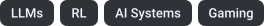
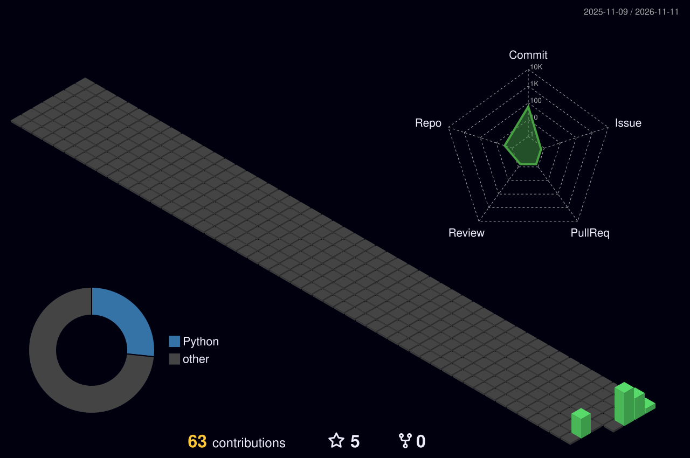

 
 
<picture>
  <source media="(prefers-color-scheme: dark)" srcset="./assets/sub-dark.svg" />
  <source media="(prefers-color-scheme: light)" srcset="./assets/sub-light.svg" />
  
</picture> 
 
 
 
 

<table>
  <tr>
    <td valign="top">
      
       
      
    </td>
    <td valign="top">
      
    </td>
  </tr>
</table>

## Contribution Snake

<picture>
  <source media="(prefers-color-scheme: dark)" srcset="https://raw.githubusercontent.com/Chuming000/Chuming000/output/github-snake-dark.svg" />
  <source media="(prefers-color-scheme: light)" srcset="https://raw.githubusercontent.com/Chuming000/Chuming000/output/github-snake.svg" />
  
</picture>

## Contribution 3D

<picture>
  <source media="(prefers-color-scheme: dark)" srcset="./profile-3d-contrib/profile-night-green.svg" />
  <source media="(prefers-color-scheme: light)" srcset="./profile-3d-contrib/profile-green.svg" />
  
</picture>

<i>"Talk is cheap. Show me the code."</i>

